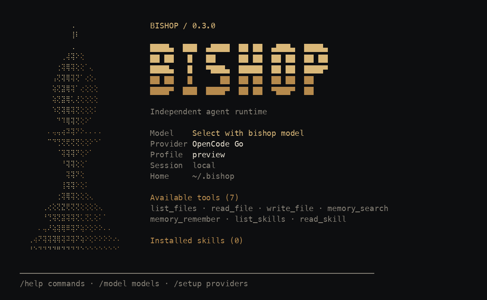

# Bishop


**An independent personal agent runtime with durable conversations, explicit tool approvals and audit checkpoints.**

Bishop owns its model loop, tool dispatch, memory, skills and Telegram channel. It does not run on Hermes or delegate execution to another agent framework. [Agent Experience Kit](https://github.com/kofiowusuai-lab/agent-experience-kit) is its checkpoint and audit library, pinned to a released commit.

Version 0.3.1 is a local-first alpha. MIT licensed. Python 3.10+; Git is needed to install the pinned AEK dependency. Commands currently target macOS/Linux.

## Launch Bishop

Install the public repository as a standalone command using [uv](https://docs.astral.sh/uv/):

```sh
uv tool install git+https://github.com/kofiowusuai-lab/bishop.git
uv tool ensurepath
bishop
```

Open a new terminal after `ensurepath` if your shell has not refreshed its PATH. The command works from any folder; state stays in `~/.bishop`. To update later, run `uv tool upgrade bishop-runtime`.

For development in this checkout, activate `.venv` and run `bishop`.

Bishop opens a finely shaded braille Bishop mark, custom wordmark and compact gold boot layout and an interactive conversation. On first launch, choose a provider and plan with the arrow keys, choose how to manage its key, then select a model from its live searchable catalog. Profile names are assigned automatically; only secrets and an optional custom endpoint require text entry. Writes and commands can be approved inline. `/help` shows chat commands; `/model` directly opens the active provider model picker; `/setup` adds another provider/key. Narrow terminals and `NO_COLOR` are supported.

```sh
bishop setup                   # add another saved provider/key
bishop providers list          # redacted saved profiles
bishop providers use work      # explicitly select one
bishop preview                 # boot screen, no model call
```

### Terminal commands

Use `bishop model` for the active provider model catalog and `bishop providers select` to switch saved providers, `bishop login` / `bishop logout` for ChatGPT authentication, and `bishop status` or `bishop doctor` for offline readiness checks. `bishop config` shows sanitized configuration; `bishop tools list` and `bishop skills list` inspect available capabilities. Existing `bishop status RUN_ID` still shows a specific run.

[Full command reference and Hermes capability comparison](docs/command-capabilities.md) distinguishes working commands from systems still to build.

Profiles can hold separate OpenCode, Claude API, OpenRouter, OpenAI API, Ollama, LM Studio and custom compatible credentials. OpenCode has Zen, Go and Free plan menus. Model choices automatically select the matching chat, Claude or Responses protocol; there is no automatic paid fallback. Secrets are saved separately in private `credentials.json`, bound to the exact endpoint and protocol. Provider-specific environment variables override saved keys. These private files are not encrypted at rest.

### Continue with ChatGPT

```sh
bishop auth login              # browser OAuth, then account-specific model picker
bishop auth status
bishop auth logout
```

You can also choose **Continue with ChatGPT** in setup. Bishop registers its own OAuth client and keeps its own tokens; its independent runtime calls the public Responses API directly. It does not run Codex or reuse Hermes credentials. Login eligibility, available models and plan limits come from OpenAI. The adapter preserves reasoning continuation across tool approvals and restarts. [OAuth details and official sources](docs/chatgpt-oauth.md).

Authentication is tested with simulated browser callbacks and signed test tokens. Real account login and live model inference require your own acceptance check. Setup never makes a test inference request. API-key providers can charge for tasks you submit.

## Try it without credentials

From this checkout:

```sh
python3 -m venv .venv
source .venv/bin/activate
python -m pip install .
bishop demo
```

The `demo` command is a diagnostic, not the interactive agent launch. It uses the **real runtime and tools**, with explicitly scripted model responses. It reads a brief, pauses before writing, approves the exact call, resumes, reopens persistent state and checks the AEK outbox. It uses a new temporary home and contacts no model or Telegram service. It does not demonstrate live model quality.

To keep demo files in a chosen empty directory:

```sh
bishop --home ./bishop-demo demo
```

## Configure your own model

```sh
bishop init
```

Edit `~/.bishop/config.json`. The default endpoint is `http://127.0.0.1:11434/v1`; use `bishop setup`, select Ollama or LM Studio and pick an installed model. Existing environment-based configurations remain supported for automation:

```sh
export BISHOP_MODEL='your-installed-model'
bishop chat 'List the files in your workspace'
bishop chat --session project-a
```

No model is selected or downloaded automatically. All preset providers expose a model picker. If a catalog cannot be loaded, choose Retry or Back; existing profiles can explicitly retain their current model. Advanced custom endpoints must expose a model catalog. [Catalog behavior and supported protocols](docs/provider-catalogs.md).

The HTTP adapter implements the chat-completions function-calling subset documented by [Ollama](https://github.com/ollama/ollama/blob/main/docs/api/openai-compatibility.mdx). Other compatible endpoints require your own verification. Remote providers require HTTPS. Set `provider.base_url`, an explicit model and `BISHOP_MODEL_API_KEY` for your chosen endpoint; live calls may incur that provider's charges.

Bishop does not automatically load `.env` files. Config holds environment variable names rather than secret values. `bishop init` never overwrites existing config or starts a bot.

## Tools and approvals

Read tools run automatically. File writes and memory additions require operator approval; commands are hidden unless `allow_command` is explicitly enabled. All filesystem tools operate in `~/.bishop/workspace`.

```sh
bishop status RUN_ID
bishop approve RUN_ID CALL_ID
bishop resume RUN_ID
# Or reject the specific call and continue:
bishop deny RUN_ID CALL_ID
bishop resume RUN_ID
```

`approve` records consent; `resume` performs the call. Approval is bound to actor, run, call and exact arguments. The model cannot approve itself. Review the pending arguments printed by `status` before approval.

Available tools: `list_files`, `read_file`, `write_file`, `memory_search`, `memory_remember`, `list_skills`, `read_skill`; optional `run_command` takes argv and does not invoke a shell automatically. Memory is scoped by actor across sessions. Owner-installed skills live at `~/.bishop/skills/NAME/SKILL.md`; tool access reads instructions without automatically executing scripts.

File controls reject traversal, hidden paths and static symlink escapes. **Commands grant host access, not an operating-system sandbox.** Commands can access files/network outside the workspace; enabling them is for trusted operators. File controls cannot defend against malicious concurrent host filesystem changes. Allowed Telegram operators share one workspace, rather than isolated tenant environments.

## Separate Bishop Telegram bot

Create a new Bishop bot through Telegram's BotFather. Put its token in `BISHOP_TELEGRAM_TOKEN` and add your numeric user ID to `telegram.allowed_users` in config. Do not reuse a token being polled by another agent.

```sh
export BISHOP_TELEGRAM_TOKEN='your-bishop-token'
bishop telegram --once
bishop telegram
```

Only allowlisted private text chats are accepted. Commands: `/start`, `/status [RUN]`, `/approve RUN CALL`, `/deny RUN CALL`, `/resume RUN`. Approval/resume/status by run enforce sender ownership. Groups, media, voice and attachments are outside v1.

Authorized updates enter a durable inbox before the polling cursor advances. Outgoing messages enter a journal before sending. An uncertain send is held for operator inspection, and later parts of that response wait behind it:

```sh
bishop telegram --deliveries
bishop telegram --resolve DELIVERY_ID --action sent
# If you explicitly choose to risk a duplicate after inspecting Telegram:
bishop telegram --resolve DELIVERY_ID --action retry
```

This transport does not promise exactly-once delivery. Removing a user from config blocks their queued work after restart. A single local poller is enforced. See [operations and recovery](docs/operations.md).

## Audit and QA

```sh
bishop audit
bishop review RUN_ID --report checked-report.json
bishop sync
```

Final response checkpoints prove that the response was persisted and all calls were resolved. **They do not prove factual correctness or task quality.** Independent QA is an explicit reviewer report; [the example](docs/qa-report.example.json) shows the schema. Fill it from actual review evidence.

Set `audit.hub_url` and `BISHOP_AUDIT_TOKEN` to sync one bounded batch to your existing AEK dashboard. Sync is explicit and is never started automatically. The outbox includes run/step outcomes, check flags and artifact hashes; it excludes prompts, responses, tool arguments, memory and local artifact paths. Full conversation/tool history stays in the private Bishop home. The current AEK schema aggregates failures under `external_failure`; precise sanitized categories remain in local Bishop status.

## Visual identity



Preview uses an example profile. The boot screen adapts to terminal width, keeps a compact maximum width, supports truecolor/256-color and respects `NO_COLOR`.

[Download the scalable Bishop logo](assets/bishop-kedolabs-agent-runtime-logo.svg). The optional `scripts/render_terminal_preview.py` captures ANSI output as PNG for design review; it requires Pillow and a local monospaced font (`--font` overrides the macOS default). Pillow is not a runtime dependency.

## Development

```sh
python -m unittest discover -s tests -v
python -m pip install build
python -m build
```

Tests exercise loopback fake HTTP, real SQLite persistence, tool approvals, actor isolation, crash recovery, filesystem controls, Telegram inbox/outbox and audit privacy. They do not call a live model or Telegram. CI covers Python 3.10, 3.12 and 3.13 on Linux; local validation is reported separately.

[Architecture](docs/design.md) · [interfaces](docs/interfaces.md) · [operations](docs/operations.md) · [implementation plan](docs/implementation-plan.md)
